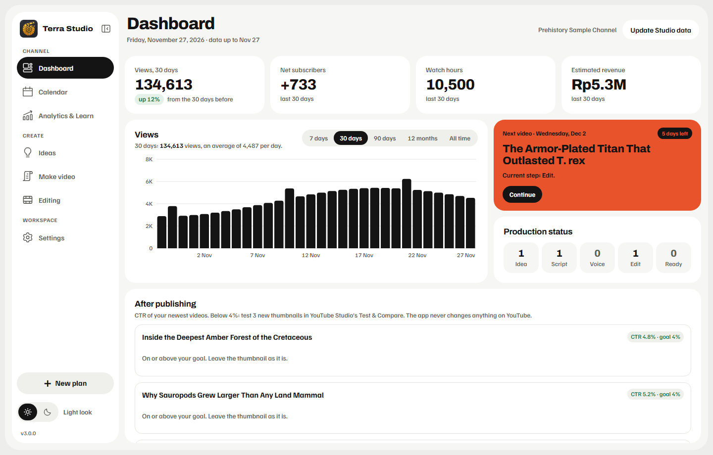
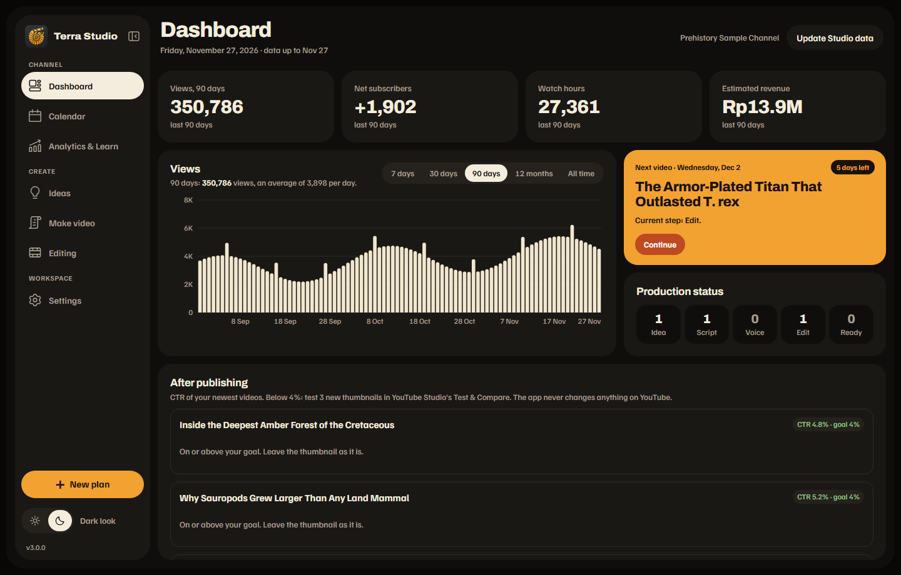
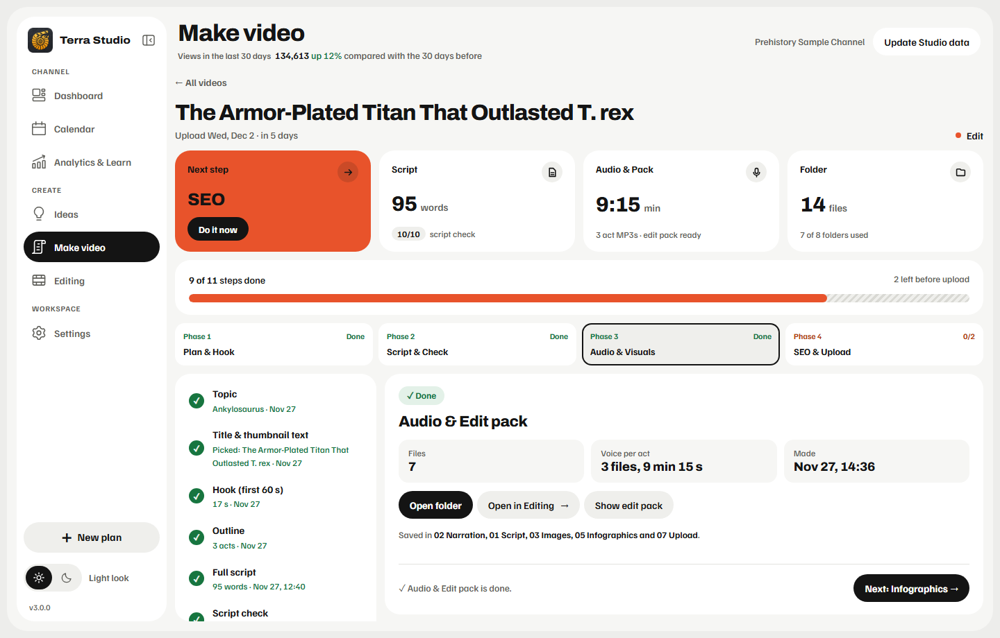
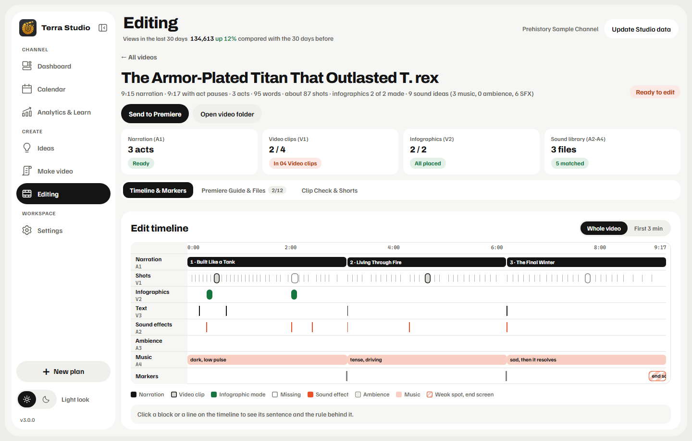
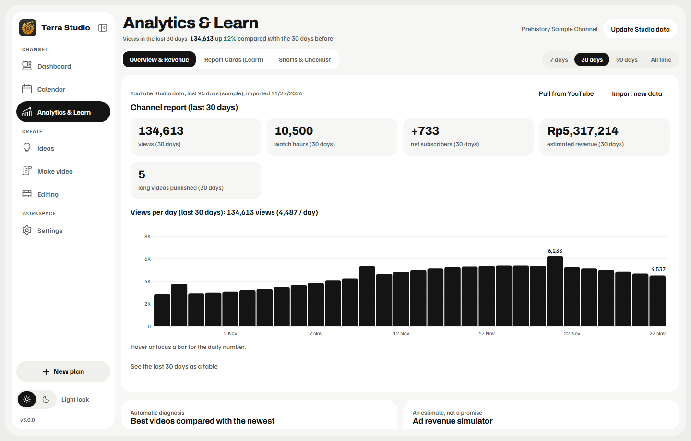

# Terra Studio

Aplikasi desktop Windows (Rust) untuk kreator YouTube dokumenter: perencanaan topik & kalender, penulisan naskah berfase, voice over lokal ([VoiceStudio](src/voicestudio.rs)) maupun ElevenLabs, integrasi [Google Flow](src/flow.rs), ekspor timeline ke Adobe Premiere Pro (FCP 7 XML), serta analitik YouTube Studio.

> **Catatan:** Semua screenshot di bawah menggunakan **data sampel sintetis** (*Prehistory Sample Channel*) dan tidak menyertakan data channel atau kunci API pribadi apa pun.

## Tampilan Aplikasi (v3.0.0)

### Dashboard (Light & Dark Look)
KPI ringkas, grafik views harian/bulanan dengan filter `7 days`, `30 days`, `90 days`, `12 months`, `All time`, pemantauan CTR setelah rilis, serta status produksi.

| Light look | Dark look |
|---|---|
|  |  |

### Make video (Alur 4 Fase)
Alur produksi terbagi ke 4 fase (`Plan & Hook`, `Script & Check`, `Audio & Visuals`, `SEO & Upload`) dengan `Audio & Edit pack` per-act serta tombol kontrol `Stop after this act`.



### Editing & Premiere Timeline
Ringkasan kesiapan Premiere (`Narration A1`, `Video clips V1`, `Infographics V2`, `Sound library A2-A4`), timeline multi-track lengkap, dan ekspor langsung ke `edit-guide.xml`.



### Analytics & Learn
Menggabungkan laporan performa & simulasi pendapatan dengan Report Cards retensi penonton serta daftar periksa Shorts, lengkap dengan filter `7 days`, `30 days`, `90 days`, dan `All time`.



## Cara kerja

- `TerraStudio.exe` menjalankan server lokal di `127.0.0.1` (port 47815 sampai 47818) dan membuka tampilan di jendela WebView2 (atau fallback browser).
- Tampilan HTML/CSS/JS berada di `assets/` dan ditanam langsung ke dalam biner saat build.
- Pengaturan terenkripsi, data Studio, kalender, dan hasil AI terakhir tersimpan lokal di `%APPDATA%\TerraStudio` (tidak termasuk dalam repositori).
- Mendukung AI lewat Gemini API, Claude API, KIE.ai, atau mode copy-paste ke claude.ai, serta TTS lokal gratis via VoiceStudio atau ElevenLabs.

## Build

```sh
# di Windows
cargo test --locked
cargo build --release --locked
```

Hasil biner rilis ada di `target/release/TerraStudio.exe` dan `target/release/TerraMCP.exe`.

## Panduan pengguna

Lihat [READ-ME-FIRST.txt](READ-ME-FIRST.txt).
